<div align="center">

<pre>
 ██████╗ █████╗ ██████╗ ███████╗██╗   ██╗██╗     ███████╗
██╔════╝██╔══██╗██╔══██╗██╔════╝██║   ██║██║     ██╔════╝
██║     ███████║██████╔╝███████╗██║   ██║██║     █████╗
██║     ██╔══██║██╔═══╝ ╚════██║██║   ██║██║     ██╔══╝
╚██████╗██║  ██║██║     ███████║╚██████╔╝███████╗███████╗
 ╚═════╝╚═╝  ╚═╝╚═╝     ╚══════╝ ╚═════╝ ╚══════╝╚══════╝

⠀⣠⣴⣶⣿⣿⣿⣿⣿⣿⣿⣿⣿⣿⣿⣿⣿⣿⣿⣿⣿⣿⣿⣿⣿⣿⣿⣿⣿⣿⣿⣿⣿⣿⣿⣿⣿⣿⣿⣿⣿⣿⣿⣿⣿⣿⣶⣦⣄
⣰⣿⣿⣿⣿⣿⣿⣿⣿⣿⣿⣿⣿⣿⣿⣿⣿⣿⣿⣿⣿⣿⣿⣿⣿⣿⣿⣿⣿⣿⣿⣿⣿⣿⣿⣿⣿⣿⣿⣿⣿⣿⣿⣿⣿⣿⣿⣿⣿⣆
⣿⣿⣿⣿⣿⣿⣿⣿⣿⣿⣿⣿⣿⣿⣿⣿⣿⣿⣿⣿⣿⣿⣿⣿⣿⣿⣿⣿⣿⣿⣿⣿⣿⣿⣿⣿⣿⣿⣿⣿⣿⣿⣿⣿⣿⣿⣿⣿⣿⣿
⠹⣿⣿⣿⣿⣿⣿⣿⣿⣿⣿⣿⣿⣿⣿⣿⣿⣿⣿⣿⣿⣿⣿⣿⣿⣿⣿⣿⣿⣿⣿⣿⣿⣿⣿⣿⣿⣿⣿⣿⣿⣿⣿⣿⣿⣿⣿⣿⣿⠏
⠀⠙⠻⠿⣿⣿⣿⣿⣿⣿⣿⣿⣿⣿⣿⣿⣿⣿⣿⣿⣿⣿⣿⣿⣿⣿⣿⣿⣿⣿⣿⣿⣿⣿⣿⣿⣿⣿⣿⣿⣿⣿⣿⣿⣿⣿⠿⠟⠋
</pre>

**The iOS capsule, on your own HTML elements.**<br>
<sub>by <a href="https://oubble.com">Oubble</a></sub>

Calibrated against a native iOS button to under half a pixel, with continuous corners for every other radius.<br>
No SVG. No wrappers. Zero dependencies. 3 kB.

[](https://www.npmjs.com/package/@oubble/capsule) [](https://bundlejs.com/?q=@oubble/capsule) [](https://github.com/oubble/capsule/actions/workflows/ci.yml) [](./src/core.ts) [](./LICENSE)

</div>

<p align="center">
  
</p>

<p align="center">
  <a href="https://lab.oubble.com/capsule/"><b>Live lab ↗</b></a> &nbsp;·&nbsp;
  <a href="#quick-start">Quick start</a> &nbsp;·&nbsp;
  <a href="#api">API</a> &nbsp;·&nbsp;
  <a href="#geometry">Geometry</a> &nbsp;·&nbsp;
  <a href="./llms.txt">llms.txt</a>
</p>

<sub>The capsule in the banner is drawn by the package itself: `capsulePath(500, 100)` rasterized to Braille, one point-in-path test per dot.</sub>

---

## Why

`border-radius: 9999px` draws a rectangle with two half-circles glued on. The
straight edge hits the circle head-on, and the eye catches the seam. A native
iOS capsule starts bending earlier along the edge and eases into a cap of the
full radius, so there is no point where straight visibly turns round.

CSS cannot express that curve. Figma's corner smoothing collapses to zero on a
fully rounded pill, and `corner-shape: squircle` flattens the cap. Capsule
computes the exact outline for each element's size and applies it with
`clip-path`. Your `<button>` stays a `<button>`: focus, forms, accessibility
and event handling are untouched.

```
          border-radius: 50%                          capsule
    ─────────────────────╮                ──────────────────────╮
                         │ ← seam: the                           ╲  ← the edge eases
                         │   curve starts                         ╲    into the cap
                         ╰─╮ at full                               ╰╮
                           ╰╮ strength                              ╰╮
                            │                                        │
```

At real size the difference is under a pixel; it is felt more than seen. Each
window below magnifies one corner, more in depth than along the edge, and fills
exactly what Capsule changes:

<p align="center"></p>

## Install

```sh
npm i @oubble/capsule   # pnpm add · yarn add · bun add
```

```html
<!-- or straight from a CDN, no build step -->
<script src="https://unpkg.com/@oubble/capsule"></script>
```

## Quick start

```html
<button data-capsule>Continue</button>
```

```js
import '@oubble/capsule'
```

That is the whole integration. Every `[data-capsule]` element in the document is
mounted, including elements inserted later by any framework.

The element's own `border-radius` picks the shape. None, or a full radius, gives
the calibrated capsule. Anything smaller gives a continuous corner of that
radius, the smoothed corner iOS and Figma draw:

```html
<div data-capsule style="border-radius: 24px">Card</div>
```

`--capsule-smoothing` sets how much of each corner is smoothed, from `0`
(exactly `border-radius`) to `1`. The default, `0.6`, is Figma's iOS preset.

## Recipes

<table>
<tr><th>Goal</th><th>Do</th><th>Why</th></tr>
<tr>
<td>Solid fill</td>
<td>

```css
.cta { background: #d3b885; }
```

</td>
<td>The element's background is read once and painted inside the capsule.</td>
</tr>
<tr>
<td>Stroke (ghost button)</td>
<td>

```html
<button data-capsule data-capsule-stroke="2"
        style="--capsule-stroke: #d3b885">Ghost</button>
```

</td>
<td>A real transparent hole (<code>evenodd</code>). <code>--capsule-stroke</code> takes any paint, gradients included.</td>
</tr>
<tr>
<td>Hover colour</td>
<td>

```css
.cta:hover { --capsule-fill: #0a84ff; }
```

</td>
<td><code>:hover</code> cannot be observed from script, so state colours go through the custom property.</td>
</tr>
<tr>
<td>Shadow</td>
<td>

```css
.cta { filter: drop-shadow(0 12px 24px rgb(0 0 0 / .35)); }
```

</td>
<td><code>drop-shadow</code> follows the silhouette. <code>box-shadow</code> follows the rectangle (<a href="#oub001">OUB001</a>).</td>
</tr>
<tr>
<td>No-JS fallback</td>
<td>

```css
[data-capsule] { border-radius: calc(infinity * 1px); }
```

</td>
<td>Before the script runs you get an ordinary pill; Capsule neutralizes it when it mounts.</td>
</tr>
</table>

Transforms, filters, opacity and transitions on the element all behave as usual.

## Frameworks

The attribute is the API, so there is nothing framework-specific to install.
Import `@oubble/capsule` once in your entry file and render `data-capsule` anywhere:

```jsx
<button data-capsule className="cta">Continue</button>          // React, Solid, Preact
```
```vue
<button data-capsule class="cta">Continue</button>               <!-- Vue, Svelte, Astro -->
```

The package is SSR-safe: nothing touches the DOM until it runs in a browser.
For explicit lifecycles, use `@oubble/capsule/core`, which has no side effects:

```tsx
import { mount } from '@oubble/capsule/core'

useLayoutEffect(() => mount(ref.current!), [])                   // returns its own cleanup
```

## API

Three entry points, one shared runtime. Each is tree-shakable ESM with types.

| Import | Side effects | Contents |
| --- | --- | --- |
| `@oubble/capsule` | mounts `[data-capsule]` on import | everything below |
| `@oubble/capsule/core` | none | `mount` · `unmount` · `observe` · geometry |
| `@oubble/capsule/geometry` | none, no DOM | `capsulePath` · `capsuleRingPath` · `roundedPath` · `roundedRingPath` |

```ts
mount(host: HTMLElement): Unmount
```
Paints the capsule on `host` and keeps it fitted as it resizes. Calling it again
re-reads the element's background and stroke. Returns a function that unmounts.

```ts
unmount(host: HTMLElement): void
```
Removes the capsule. Every inline style Capsule touched is restored to its exact
previous value and priority; a `style` attribute it had to create is removed.

```ts
observe(root?: Document | ShadowRoot | Element, options?: { selector?: string }): () => void
```
Mounts every match under `root` (default `document`, selector `[data-capsule]`)
and follows the tree: insertions mount, removals unmount, edits to `class` or
`data-capsule*` re-read the element. Pass a `ShadowRoot` to cover web
components. Returns a disconnect function that unmounts what it mounted.

```ts
capsulePath(width: number, height: number, x?: number, y?: number): string
capsuleRingPath(width: number, height: number, thickness: number): string
```
Pure geometry as SVG path data, usable in `clip-path: path()`, `<path d>`,
`Path2D`, canvas or a design tool export. Invalid sizes throw `RangeError`.

```ts
roundedPath(width: number, height: number, radius: number | Radii, smoothing?: number, x?: number, y?: number): string
roundedRingPath(width: number, height: number, radius: number | Radii, thickness: number, smoothing?: number): string
```
A rectangle with continuous corners. `radius` is one value or four, clockwise
from the top left; radii above half the short side are clamped and the
smoothing fits what is left. `smoothing` defaults to `IOS_SMOOTHING` (0.6).

## Geometry

Each quadrant is two cubic Béziers: a **transition** that leaves the straight
edge early, and a **cap** that is a true circle of the full radius `R = h / 2`.
The radius is never shrunk to compensate, which is why the capsule keeps its
full height at the ends.

<p align="center"></p>

The four constants were fitted by least squares to the outline of a native iOS
capsule, extracted from a screenshot with sub-pixel edge detection. Maximum
deviation from the reference: **under 0.5 px**.

| Symbol | Value | Meaning |
| --- | --- | --- |
| λ | `0.4154` | How far past the tangent point the edge starts to bend, in R |
| φ | `0.5976` rad (34.24°) | Where the transition meets the cap, measured from the top of the circle |
| h₀ | `0.2591` | Edge-side control handle, in R |
| h₁ | `0.3102` | Cap-side control handle, in R |

Measured properties of the emitted outline (unit capsule, `R = 1`):

| Property | Value |
| --- | --- |
| Curvature where the transition leaves the edge | κ·R = 0.012 |
| Tangent continuity at the cap junction | exact (G¹) |
| Radial error of the cubic cap against a true circle | 1.5 × 10⁻⁵ · R |
| Deepest inset against a `border-radius` capsule | 0.020 · R (0.75 px on a 75 px button) |
| Outward excursion past the bounding box | 2.4 × 10⁻⁷ · R |
| Output precision | 10⁻³ px, below any rasterizer |

Below an aspect ratio of `1 + λ` the transitions of opposite corners would
overlap. They scale down together, and a square box degenerates into an exact
circle. Tall boxes are generated transposed, so vertical capsules are the same
curve rotated, not a different fit.

## How it works

```
  import '@oubble/capsule'
        │
        ▼
  observe(document) ───── MutationObserver ───── childList · class · data-capsule*
        │                        │
        │ match                  │ removed ──▶ unmount(host) ──▶ inline styles restored
        ▼                        ▼
  mount(host)
   ├─ getComputedStyle ────────── background · writing-mode · diagnostics
   ├─ inline !important ───────── background → transparent · radius → 0 · isolation
   ├─ adoptedStyleSheets ──────── [data-capsule-state]::before { clip-path: var(--_capsule-clip) }
   └─ ResizeObserver (shared) ─── borderBoxSize ──▶ capsulePath(w, h) ──▶ --_capsule-clip

                       ┌──────────── host <button> ────────────┐   transparent, isolated
                       │  ╭─────────── ::before ─────────────╮ │   background + clip-path
                       │  │          children, focus,        │ │
                       │  ╰───────── events, a11y ───────────╯ │
                       └───────────────────────────────────────┘
```

- **The element is never wrapped.** The background moves to `::before`, which
  is clipped. The element itself is not, so `filter`, `transform` and focus
  rings on it keep working.
- **One `ResizeObserver` for every element.** It reads `borderBoxSize`, which is
  fractional and ignores transforms, so a `scale()` hover never triggers a refit.
- **No polling and no per-frame work.** A resize costs one path string,
  about 4 µs.
- **Exact teardown.** Only inline longhands are written, each one recorded with
  its previous value and `!important` priority.
- **Shadow DOM and iframes.** Styles are installed per root node, with one
  constructed stylesheet per document.

## Browser support

| Feature | Chrome / Edge | Safari | Firefox | When missing |
| --- | --- | --- | --- | --- |
| `clip-path: path()` | 88 | 13.1 | 97 | no-op, the element keeps its own CSS |
| `path(evenodd, …)` for strokes | 88 | 13.1 | 97 | stroke renders solid ([OUB004](#oub004)) |
| `adoptedStyleSheets` | 73 | 16.4 | 101 | falls back to a `<style>` element |
| `ResizeObserver` `borderBoxSize` | 84 | 15.4 | 92 | falls back to integer `offsetWidth` |

The suite runs on every commit in Chromium, Firefox and WebKit.

## Diagnostics

Capsule warns once per element when CSS would silently render the wrong shape.
Each message carries a code that links here.

### OUB001

`box-shadow` follows the element rectangle, not the capsule. Use
`filter: drop-shadow()`.

### OUB002

`border` follows the element rectangle. Use `data-capsule-stroke="N"` and
`--capsule-stroke`.

### OUB003

`::before` is already styled on the element. Capsule paints the capsule with it;
move the decoration to a child element.

### OUB004

The browser lacks `clip-path: path(evenodd, …)`, so a stroke renders as a solid
capsule in the stroke colour.

## Limitations

- **One radius per corner.** Elliptical radii (`12px / 6px`) use their
  horizontal value.
- **`::before` is reserved** on mounted elements.
- **Background changes made by `:hover` or inline styles** are not observed;
  route them through `--capsule-fill`. Changes through `class` are picked up.

## Security

- **Zero runtime dependencies.** The published package is the `dist` folder,
  nothing else.
- **No network, no `eval`, no HTML parsing.** Strings written to the DOM are
  numeric path data and computed CSS values.
- **Content Security Policy.** Styles are applied through the CSSOM
  (`adoptedStyleSheets`, `style.setProperty`), which strict CSP allows. The
  suite verifies this under `default-src 'self'` with no inline styles allowed,
  and the [live lab](https://lab.oubble.com/capsule/) is served under
  `default-src 'none'`.
- **Provenance.** Releases are built and published from GitHub Actions with
  [npm provenance](https://docs.npmjs.com/generating-provenance-statements),
  so every version links to the exact commit and workflow that built it.

Report vulnerabilities privately; see [SECURITY.md](./SECURITY.md).

## Development

```sh
pnpm install
pnpm dev            # the lab at http://localhost:4174/capsule/, with production headers
pnpm verify         # lint · types · unit · build · package lint · size · browsers
pnpm figures        # regenerate the README figures from the built package
```

See [CONTRIBUTING.md](./CONTRIBUTING.md).

## For AI agents

[`llms.txt`](./llms.txt) is a short brief for coding assistants: setup, the
rules that keep the shape correct, and the API. It ships in the package.

## License

[MIT](./LICENSE) © [Victor Barbosa Ramos](https://oubble.com)

<p align="center"><br><br><sub>outside the bubble</sub></p>
